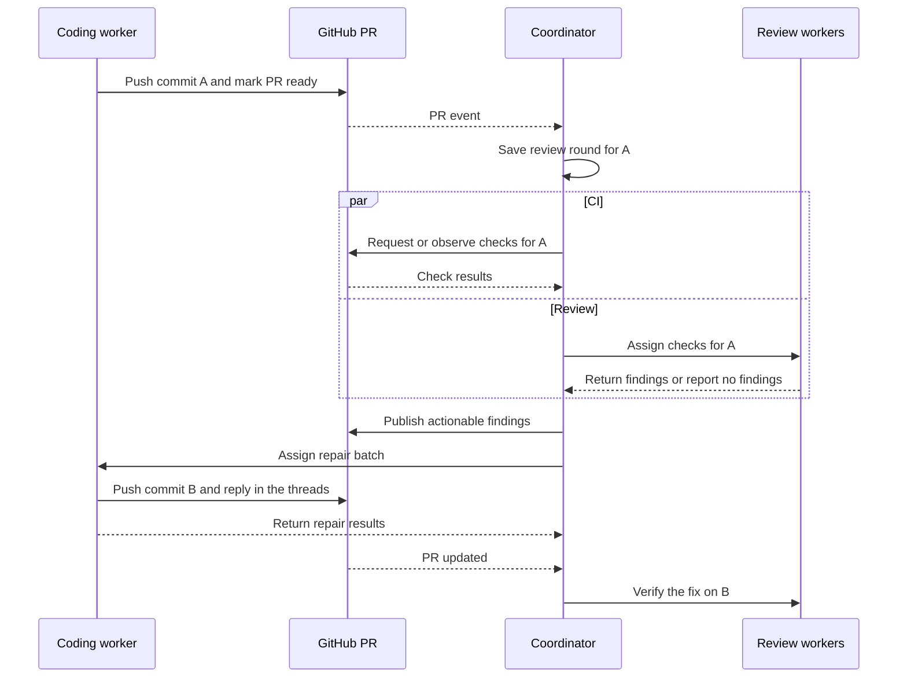

# Closing the Loop Between Coding Agents and Code Review

A reviewer flags a possible double write when a client retries a request. The coding agent points to a unique constraint. While the two are discussing whether retries use the same key, a new commit lands on the pull request. The finding still matters, but the reviewer examined the previous commit. Someone also needs to decide whether a retry should return the original result or a conflict.

A durable coordinator can keep that work moving. GitHub holds the discussion and decisions. The coordinator tracks which commit was checked, what each worker returned, and what must happen before the pull request can move forward.

## Keep the discussion in the PR and the workflow state in the coordinator

The coding agent prepares and revises the patch. Reviewers examine a fixed version of it and return findings with evidence. The coordinator assigns work, applies the policy for moving between steps, and publishes review comments. The human owns changes to the accepted behavior and the decision to integrate.

Keep one review conversation on the pull request, with one thread per actionable finding. Record the scenario, the author's response, the fix commit, and the verification in that thread. The coordinator can publish results from several reviewers and identify the source of each finding. Give each finding an identifier that survives edits to the file and the wording of the comment.

The coordinator stores assignments, results, attempts, and links to the GitHub threads. It can hand the next worker the current commit, the relevant discussion, and the decision still needed. A replacement worker can pick up from that record after the original session ends. The broader delivery workflow has similar handoffs between intake, development, and deployment. [[Coordinating Coding Agents in the SDLC]]

## Start review on an explicit signal and pin it to a commit

The author can push work in progress to a draft PR and mark it ready when the patch is ready for review. On GitHub, the coordinator can react to `ready_for_review` or an `opened` event for a PR already ready for review. A later `synchronize` event tells it to check for a new head. Before scheduling jobs, the coordinator reads the current PR state and records the commit and comparison base. [GitHub pull request events](https://docs.github.com/en/actions/reference/workflows-and-actions/events-that-trigger-workflows#pull_request)

A webhook tells the coordinator that something happened on GitHub. A worker result tells it which assignment completed and what the worker found. The runner can save that result directly, including an explicit result when the reviewer finds no issues. A required check that timed out remains incomplete. While it waits for a stored result, the coordinator can handle other pull requests.

## Keep findings open until someone verifies the outcome

For the retry finding, the reviewer first checks whether two requests use the same key and what happens when the second insert hits the unique constraint. A useful finding states the conditions, the observed or expected failure, and its effect on the caller. A plausible high-impact concern can justify a focused investigation. A small improvement can stay advisory. [[LLMs as a Code Review Team]]

The coding agent can add a regression test and fix the conflict handling, or show that the existing path already handles the case. A reply with a commit and a passing test moves the finding to verification. The reviewer checks that the test exercises the retry path and fails when the regression is present. The thread records whether the fix was verified, the claim was refuted, or a human accepted the remaining risk.

If the original task leaves the retry response unspecified, the unique constraint settles only the question of duplicate writes. Returning the original result and returning a conflict expose different behavior to callers. The contract owner chooses, and the decision becomes part of the acceptance criteria. When the patch changes existing tests, review the affected assertions against those authorized criteria. A green suite can hide a lost guarantee if the patch also weakens the test. [[When Is an AI Agent’s Code Ready to Merge]]

## Batch repairs and resume from recorded results

Run independent checks in parallel. A migration reviewer can wait for a migration test that supplies needed evidence while a general reviewer reads the diff. Publish actionable findings as they arrive, then collect them into one repair assignment once the required checks for the round have finished. Pushing after every finding can leave the rest of the reviewers working on a version the author has already replaced. Start with one worker allowed to update the PR branch. When repairs are prepared in parallel, one worker integrates them and tests the combined change before pushing.

Two failures show why the coordinator needs its own record:

- **The coordinator restarts after GitHub accepted a review comment.** Store the intended publication with its finding identifier before calling GitHub. On recovery, check whether the matching comment already exists before trying again. Use a single publisher for that operation so concurrent attempts cannot both decide to post it.
- **A person pushes while review is running.** The late result is evidence for the original commit. The coordinator checks the current PR version before using it to advance the workflow and schedules checks for the new version. A repair must also stop if the branch changed while the worker was preparing its patch. A completion from an expired assignment cannot advance the round.

Save incoming events before acknowledging delivery. Deduplicate repeated deliveries, and periodically compare active PRs with GitHub so a missed event does not leave a round waiting indefinitely. Renew or expire work claims, and persist completed results so a restart does not require repeating successful model calls. [GitHub guidance on webhook deliveries](https://docs.github.com/en/webhooks/using-webhooks/best-practices-for-using-webhooks) · [Failed webhook deliveries](https://docs.github.com/en/webhooks/using-webhooks/handling-failed-webhook-deliveries)

## Give the human a decision to make

The human sets the scope and acceptance criteria before implementation. During review, the human can pause automatic edits, decide a disputed requirement, or approve a specific exception. If successive patches undo earlier fixes, the same objection returns without new evidence, or a required check cannot complete within its budget, stop automatic repair. Send the human the disputed finding, the latest relevant diff, the evidence and attempts so far, and the consequences of each available decision.

Treat a PR comment as material for review. An action that resumes automation, accepts an exception, or expands the scope requires an authorized actor. The coordinator can publish a check for the current candidate once required checks have succeeded and blocking findings have a recorded disposition. Human approval remains a separate condition for integration. [GitHub protected branch rules](https://docs.github.com/en/repositories/configuring-branches-and-merges-in-your-repository/managing-protected-branches/about-protected-branches)

## Pay for another pass when it can change the outcome

Give the coding agent the rules that affect the design before it writes the patch. Put precisely checkable rules in CI. A dependency rule can run across the whole repository without asking a model to read it. One general reviewer can usually share context across behavior, tests, and task intent. Add a specialist when the change raises a separate question with different evidence, such as whether old and new application versions can both use a schema during a rollout. [[How Much Guidance Does a Coding Agent Need]]

A reasonable first experiment is one general reviewer, specialists triggered by specific risks, and one automatic repair batch for confirmed findings, followed by verification. A second repair batch needs fresh evidence or a human decision and must fit the PR's budget. Compare the same historical PRs with and without specialist review, including changes with known regressions and clean changes. Track confirmed findings, missed regressions, false alarms, model and tool costs through repair, time to readiness, and minutes of human attention. The extra pass earns its cost when it finds something consequential or settles a decision the existing checks would leave open. [[Operating an Automated Code Review Service]]
