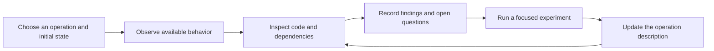

A team wants to replace an old service, perhaps together with a Windows Forms client, in another language. The source is available, but nobody has a complete account of its behavior. Some rules live in button handlers, others in stored procedures, configuration, or scheduled jobs. Asking an agent to translate the code immediately would carry these uncertainties into the replacement.

The useful first result is a description of important operations backed by source references and repeatable observations. It should explain what happens, under which conditions, what remains uncertain, and which behavior the replacement must preserve. This note proposes a way to build that description incrementally; it does not assume that an agent can prove a whole legacy system understood.

## Recover Current Behavior Before Choosing Target Behavior

Begin with a concrete question: what allows an order to be approved, what changes when approval succeeds, and what remains after a failure? A list of classes will help navigation, but will not answer that question.

Keep three things distinct throughout the investigation:

| Record | Purpose |
|---|---|
| Current behavior | What the legacy version does under stated conditions, with supporting evidence |
| Target decision | Whether to preserve, change, or retire that behavior, and why |
| Verification case | How to check the chosen behavior in the replacement |

An unexpected rounding result may be a defect, a compatibility requirement, or an unresolved question. Recording it does not make it a requirement. Conversely, finding it strange does not authorize the agent to correct it during a behavior-preserving rewrite.

Record the source revision, relevant configuration, database schema, and available runtime environment. A commit alone cannot reproduce an operation whose stored procedures or feature settings exist outside the repository. If the application cannot be run, static findings remain useful, but the report must identify which claims lack execution evidence.

## Build a Map of the Available Evidence

The investigation starts with more than the current application source. Establish which materials exist, which versions they describe, and which parts of the deployed system remain inaccessible. Then consult them to answer questions about a chosen operation; reading every historical commit is not a prerequisite for beginning.

| Source | What to investigate | Limit of the evidence |
|---|---|---|
| Current code and configuration | Entry points, rules, registration, feature flags, state readers and writers | A checkout may differ from the deployed version or omit an external component |
| Documentation and design decisions | Intended behavior, terminology, integration contracts, operational procedures | A document may describe an earlier design or an unimplemented proposal |
| Git history, commit diffs, and linked issues or reviews | When a condition appeared, why a workaround exists, which regression prompted a change | A commit message explains an author's intent; inspect its diff and later changes before treating that intent as current behavior |
| Database definitions and migration scripts | Tables, constraints, views, procedures, triggers, scheduled jobs, and transformations of existing data | Scripts in the repository do not establish which changes were actually applied in each environment |
| Existing data and deployed application versions | Older record formats, partially converted data, and clients still using earlier contracts | A small sample may miss rare records or a deployment that uses a different path |
| Tests, execution traces, incident reports, and maintainer knowledge | Reproducible outcomes, failure sequences, known exceptions, and recovery procedures | Each source has a scope; an asserted expectation or remembered incident still needs to be checked against the relevant version |

For an unusual approval condition, inspect the commit that introduced it, its surrounding diff, any linked defect, and later changes to that code. A historical fix may explain why a seemingly redundant check must remain. It may also reveal that the affected integration was subsequently retired. Record the evidence and verify current consumers before deciding which conclusion applies. [[Comments May Become More Valuable in AI-Generated Code]] discusses preserving useful rationale recovered from Git history.

When documentation says one thing and execution shows another, preserve both claims with their dates and versions. The discrepancy is a question to resolve. Maintainers can explain intent, while code, configuration, and experiments establish which behavior is currently implemented.

### Recognize Historical Layers in the Database

A database with a long migration history does not necessarily contain several complete versions of its schema at once. Distinguish the sequence of applied schema changes, old and new structures that still coexist, and records created under different data conventions. Also check whether different deployed application versions or customer installations expect different database contracts.

For example, an illustrative order database might retain both `LegacyStatus` and `Status`. The current service reads `Status`, an older client still writes `LegacyStatus`, and a trigger translates between them. Alternatively, the older column may survive only because a report uses it, or because an interrupted data conversion left some rows incomplete. The names and ages of the columns do not establish which explanation is true.

For each suspected historical layer, identify its readers and writers, its meaning, the conversion rule, and the evidence that conversion finished. Compare the actual schema with migration files and the recorded migration history; investigate discrepancies such as manual changes or missing scripts. Include views, triggers, reports, imports, and consumers outside the current repository. Database evolution concerns both structure and existing data, and shared databases require coordinating their consumers. [Evolutionary Database Design](https://martinfowler.com/articles/evodb.html)

Exercise representative older and newer records where their interpretation differs. When installation history matters, compare a fresh database with one upgraded from a supported earlier state. A test using only newly created rows can miss a fallback used exclusively for historical data. The resulting inventory should say which layers remain necessary, which are candidates for retirement, and which are still unexplained.

## Investigate Operations, State, Time, and Effects

Use one operation as the unit of investigation. In an illustrative order system, approval might reserve stock, persist a pending order, and arrange for the reservation to expire if payment does not arrive. These are possibilities to investigate, not behavior to assume from a method named `ApproveOrder`.

| Dimension | Questions for the approval operation |
|---|---|
| Entry points | Can approval start from a button, an API, an import, or a message? |
| Initial state | Which customer, order status, permissions, and configuration apply? |
| Rules | Which conditions allow approval? Where do limits and defaults come from? |
| Immediate effects | Which records, files, and outgoing messages change? |
| Time and background work | What happens after a deadline, on a scheduler run, or when a callback arrives? |
| Failure and repetition | What survives a partial failure? What happens on retry or duplicate delivery? |
| Concurrent activity | Can payment, cancellation, and expiry act on the same order? |

For a desktop client, the sequence of interactions may be part of the behavior. A field-change handler might calculate a value that the Save button later reads from a hidden control. Opening the form, changing a selection, cancelling, and reopening can therefore produce different inputs to the same save method. Trace who writes the state as well as who reads it.

Time needs an equally concrete description. An order becoming ineligible exactly at its deadline, a periodic worker updating its status later, and an update triggered by the next read are different mechanisms. Determine which mechanism applies, what happens during downtime, and how competing events are resolved. A successful click followed by a changed row does not explain these later effects.

### Describe Individual Rules Within the Operation

An operation can contain several rules. For each one, state the initial state, triggering event, applicable conditions, effects, resulting state, and timing. Link that rule to its evidence and checking cases. This makes a broad description such as "approval works" precise enough to investigate.

For example, a hypothetical expiry rule could read: "When the expiry worker examines a pending, unpaid order whose stored deadline has passed, it marks the order expired and releases its reservation." This wording identifies the actor and trigger; the passing deadline alone is not described as executing the update. Transaction boundaries, retry behavior, and the maximum delay before the worker runs remain separate questions.

The following illustrates how several rules can form a lifecycle. These are invented example results, not findings from an inspected system or requirements to impose on one:

| Event and initial conditions | Example rule or remaining question |
|---|---|
| Approval of an eligible draft order | Reserve stock, record a pending order, and store its expiry deadline |
| Approval for different customer categories | Use a configured 15-minute or 30-minute interval when setting that deadline |
| First payment notification while pending and before the deadline | Record the payment and change the order to paid |
| Repeated notification with an already processed payment identifier | Preserve the recorded payment without applying it again |
| Expiry worker examines an unpaid pending order after its deadline | Change the order to expired and release the reservation |
| Payment and expiry compete near the deadline | Unresolved: establish the boundary condition and which update can win |

Each row leads to focused evidence: the deadline calculation, duplicate detection, persisted transitions, or concurrent update behavior. A real card should replace example outcomes with actual findings and retain unresolved rows until they are investigated.

## Alternate Observation and Source Investigation

First build a modest system map: applications, services, databases, integrations, entry points, and background processes. Use it to choose a representative operation and locate missing dependencies. Deep analysis then proceeds one operation at a time.

Observation suggests questions for code inspection; code inspection suggests cases that ordinary use would miss. If a condition exempts a particular customer category below a configurable limit, investigate how the category and limit are obtained, what happens exactly at the limit, and whether another entry point bypasses the check. Not every conditional is a business rule: some control error handling, caching, or a workaround. Follow its effect before deciding what the replacement needs to preserve.

Starting from one method can lead into a large graph. Calls converge on shared methods, callbacks create indirect paths, and state may have been written before the operation began. A call graph is a navigation aid. It needs to be combined with data reads and writes, registration and configuration, and runtime evidence where available.

Consider two consecutive calls: `repository.Save(order)` and `scheduler.Schedule(order)`. Describing each separately leaves a crucial question unanswered: what remains if the save succeeds and scheduling fails? Inspect transaction ownership, compensation, and recovery. A transaction may start in a caller or framework layer outside the two methods.

For each unresolved dependency, record a question and a next action. For example: "The repository calls a stored procedure absent from this checkout; obtain its definition or inspect its effects in an isolated database." Continue independent investigation, but keep the persistence claim incomplete.

Reuse earlier findings when their assumptions apply. A repository studied outside a transaction may behave differently when called inside one. Marking a method as visited is insufficient; retain the relevant arguments, configuration, transaction context, and state assumptions. For cycles or repeated processing, describe the transition and termination conditions rather than endlessly expanding another copy of the call chain.

Do not expand every library implementation. State the contracts accepted as boundaries and investigate further when the operation depends on an uncertain detail. The aim is to resolve questions about behavior, not to maximize the number of files read.

### Track Shared Fragments and Open Dependencies

Alongside operation cards, keep short records for fragments that several operations depend on. Each record needs its context, established behavior, dependencies, evidence, open questions, and next step. The following is an illustrative investigation state:

| Fragment | Finding and context | Open dependency or next step |
|---|---|---|
| Deadline calculation | Under the recorded configuration, maps customer category to an interval; source location and calculation cases attached | Recheck callers that use a different configuration source |
| Order persistence | The handler invokes a stored procedure; the current procedure definition is unavailable | Obtain the definition and establish its writes and transaction boundary |
| Expiry scheduling | A trace records successful job submission during the approval scenario | Determine whether storage and restart recovery preserve the job |
| Approval operation | Eligibility and deadline rules explained for the chosen cases | Overall analysis remains partial while persistence and recovery are unresolved |

A shared fragment's record can support several operations without being re-investigated from scratch. Reuse it only under matching assumptions and source versions. A parent operation remains incomplete when an unresolved dependency can change its outcome, even if the agent has visited every available source file.

### Choose Cases Without Enumerating Every Path

Even ten independent binary conditions can produce 1,024 combinations; stateful loops and event sequences create further possibilities. Some combinations may be unreachable, but simply following more calls does not solve the problem. Recover the rules and their conditions, then select cases that distinguish important outcomes.

For the order lifecycle, examine each relevant customer category, times before, at, and after the deadline, first and repeated notifications, and partial failures. Combine conditions where the rules interact, such as a repeated payment after expiry. Record combinations that remain unexplored. This gives a reason for each experiment without claiming exhaustive path coverage.

## Keep Findings, Evidence, and Unknowns Together

An operation card gives the next reader enough context to understand both the result and its limits. [[AI-Generated Architectural Documentation from Code]] develops operation-oriented documentation and diagrams; for behavior recovery, add explicit evidence and unresolved questions.

The following is an illustrative card, not a report from an inspected application:

| Field | Example content |
|---|---|
| Operation and scope | Approve an unpaid order through the desktop client |
| Initial conditions | Draft order, selected customer, recorded approval configuration |
| Rules and transitions | Describe the exact eligibility condition and resulting status |
| Immediate and delayed effects | Order writes, stock reservation, expiry scheduling |
| Variants | Rejection, duplicate submission, save failure, scheduling failure |
| Source evidence | Revision, file, symbol, and relevant condition or transaction boundary |
| Execution evidence | Fixture, entry point, actions, captured results, and test or trace location |
| Unknowns | Whether a committed order without a scheduled job is recovered after restart |
| Next investigation | Force scheduling failure, restart the process, and inspect persisted state and recovery |
| Target decision | Preserve observed behavior pending a separate recovery decision |

Evidence belongs to individual claims. A card may contain a source-derived validation rule, an observed database update, and a hypothesis about recovery. Label them separately. A successful run demonstrates the exercised case; a plausible reading of code is not an observation. If the two disagree, retain the discrepancy until its cause is understood.

Agree a stopping condition for the chosen scope: relevant entry points and variants examined, important rules and effects described, representative checks recorded, and remaining gaps named. "Explained except for restart recovery" is a useful result. It is not equivalent to "ready to replace" when restart recovery is required. The acceptance decision must account for the impact of each remaining gap.

## Use Tests to Learn Before Using Them to Protect Changes

When tests are absent, writing them can be part of understanding the system. A characterization test records actual behavior for chosen conditions, rather than asserting that the behavior is desirable. Michael Feathers describes this as a discovery process: execute existing code, inspect its result, and refine the description as understanding improves. [Characterization Testing](https://michaelfeathers.silvrback.com/characterization-testing)

Choose the test boundary where the behavior can be exercised without first performing a large redesign:

| Behavior being investigated | Useful starting point |
|---|---|
| Isolated arithmetic or validation | Unit tests with explicit inputs and observed results |
| Stored procedures, triggers, or transactions | Integration tests against a controlled database |
| Form state and event ordering | Selected tests through the desktop interface |
| Delayed processing and recovery | Sequences covering events, persisted state, time, and restart where relevant |

"Characterization" describes the purpose of a test, not its level. An integration test can provide the first protection around a tangled handler. After extracting a calculation, focused unit tests can explore its boundaries more cheaply. Replacing SQL with a mock would remove the behavior under investigation if the rule actually lives in a trigger.

For the order example, prepare a known database state, invoke the selected entry point, and inspect the response, changed records, and captured outgoing work. Exercise an important failure as well as success. A mock confirming that `Schedule` was called does not establish that a job was stored durably or recovered after restarting the application; that requires a check through the relevant storage and recovery path.

Control inputs that make comparisons unstable, including the clock, generated values, configuration, and external responses. Record which dependencies are simulated. Keep effects isolated so replay does not submit the same real transaction twice. If the environment cannot reproduce a failure or concurrent sequence, document that limitation rather than counting the case as covered.

An agent can propose expected results from its reading, but execute the original to check those proposals where possible. Otherwise, the same misunderstanding can appear in the description, tests, and replacement. Review recorded results before accepting them as the compatibility baseline, and protect that baseline while changing the implementation. [[Testing in the Model, Agent, LLM Era]] explains this separation.

Assess coverage against the recovered rules, states, and effects. For each important claim, record a checking case or an explicit gap. A line-coverage report can reveal code that tests never reached, but reaching the payment handler does not establish that the test would detect a duplicate charge. Similarly, executing the expiry worker does not establish correct stock release unless the relevant state is inspected. Choose coverage that could expose a change to the behavior being preserved.

Later, equivalent cases can run against both implementations. Compare the observations that matter, including errors, ordering, persisted state, and delayed effects. Passing comparisons establish agreement for those cases, not complete equivalence. [[Existing Software as a Blueprint for AI Agents]] explains how a running reference supports this process.

## Simplify a Specific Obstacle to Understanding

Investigation may reveal that a small change would make further work easier. Introduce it to answer a named question, with a way to check the affected behavior. This creates a loop: investigation, obstacle, controlled change, comparison, further investigation.

A place where a dependency can be redirected can support both testing and observation. Fowler's explanation of legacy seams shows how such points allow replacement behavior or probes without repeatedly editing the code being exercised. Introducing the seam itself may still require a source change. [Legacy Seam](https://martinfowler.com/bliki/LegacySeam.html)

For reflection-based construction, first establish where the type name comes from: code, configuration, stored data, or external plugins. Recording selected types can explain exercised paths, but observing three implementations does not establish that only three are supported. A named wrapper with diagnostics may be enough; an explicit factory registry is appropriate only when its supported set and failure behavior are understood.

Other useful changes include naming a complex predicate, exposing a controllable clock, or separating form reads from a calculation. Preserve evaluation order, exception behavior, and the moment mutable values are read. Reading every control at the beginning of a handler can change behavior if earlier steps previously updated those controls.

Historical database layers can also be simplified before the language rewrite. One first step might put the interpretation of old and new status fields behind one explicit mapping, while retaining the supported storage formats. That reduces duplicated branching and makes the rule easier to characterize. Consolidating the stored data is a separate change: establish the mapping, test representative historical records, and check active readers, writers, and rollback needs before retiring the older structure.

When old consumers must continue running, a gradual change can add the new representation, move consumers and data, and remove the old representation after the transition is complete. This is the expand, migrate, and contract sequence described in [Parallel Change](https://martinfowler.com/bliki/ParallelChange.html). Discovery of two representations alone does not justify immediate deletion. Keeping them may be required during deployment; simplifying them first may reduce the later rewrite when their remaining obligations can be resolved.

Keep an executable reference where possible, together with the configuration and data needed to compare results. Investigative changes should remain distinguishable from that reference. If broad tests are unavailable, use the smallest viable observation or interception point and state the remaining risk; difficulty adding unit tests does not justify a large unprotected refactor. [[Refactoring Legacy Systems with AI Agents]] develops the change and comparison discipline.

## Organize the Agent Around Unanswered Questions

Start with a written procedure, a system map, operation cards, and a durable list of questions. A skill can tell the agent to read previous findings, choose a question, inspect the necessary evidence, perform available checks, and save the next step. This is already a workflow, even when there is no separate orchestration program.

Keep the responsibilities explicit:

| Part of the process | Responsibility | What it cannot establish by itself |
|---|---|---|
| Search and structural analysis tools | Locate symbols, references, callers, writes, and historical changes within their supported scope | The business meaning of a condition or completeness of dynamically selected paths |
| Agent | Connect findings into rules, identify contradictions, maintain assumptions, and select the next question | That a plausible explanation is what the deployed system actually does |
| Tests and execution observations | Exercise stated conditions and capture outputs, state transitions, and effects | Behavior outside the exercised conditions and assertions |

The records should let another session resume without reconstructing the conversation. Keep source references and assumptions alongside findings; when code or configuration changes, affected findings need review before reuse. Avoid loading every card into every task.

With a skill alone, the same model interprets the procedure, performs the work, and judges whether it finished. It may skip a dependency, accept a shallow explanation, or forget to update an open question. A written instruction helps coordinate the investigation, but does not enforce its completion conditions.

A controlling script becomes useful when repeated work needs enforced output formats, prerequisite tracking, retries, or reliable resumption. It can check whether referenced files and test artifacts exist. It cannot establish that a business interpretation is correct merely because a report is complete. Tool selection and scheduling should serve the investigation, not become prerequisites for starting it.

Try the procedure on a few representative operations and observe where it fails before automating more of it. If the agent repeatedly closes cards without evidence or loses unresolved dependencies between sessions, make those specific obligations mechanically checked. Keep judgment about the meaning and sufficiency of evidence visible to review.

A practical first pass covers one representative operation from entry point through state changes and later work. Its deliverables are a reviewed account of behavior, repeatable checks, unresolved questions, and explicit target decisions. Those provide the input to [[Large-Scale Code Migration with AI Agents]]; translation can then proceed with a defined behavioral scope and visible verification gaps.
