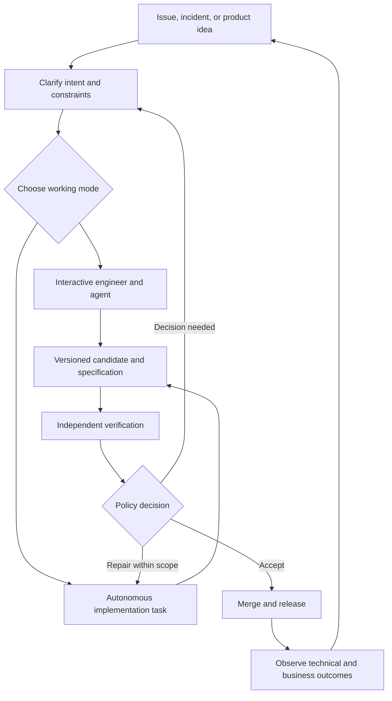

# Designing an Agentic SDLC for Business Software

A coding agent finishes a billing change in twenty minutes. That does not tell the company whether the change preserves the invoice contract, whether the previous release can still read the database, or whether customers actually need the new behavior. A useful agentic SDLC connects implementation to those decisions and keeps following the change after deployment.

The architecture described here is a proposed operating model for business software. Its automation levels are policy choices, not claims that an existing product already runs an entire company safely. The objective is to let agents do substantial work while making the grounds for accepting that work explicit.

## Give each component a clear responsibility

Three kinds of correctness need different evidence. Technical checks establish properties such as compilation, authorization behavior, and compatibility. Acceptance evidence connects behavior to agreed requirements. Business measurement asks whether those requirements produced a useful outcome. A green build cannot answer all three questions.

| Component | Responsibility | State it owns |
| --- | --- | --- |
| Product and engineering owners | Decide intent, consequential trade-offs, and permitted autonomy | Requirements, policy decisions, ownership |
| Durable orchestrator | Start work, record transitions, retry, wait, cancel, and escalate | Workflow history, task state, deadlines |
| Agent runtime | Execute a bounded assignment using available tools | Session state and execution events |
| Git and artifact storage | Preserve inputs and outputs that can be inspected again | Commits, builds, reports, evidence |
| Independent verification | Evaluate a specific candidate against a protected baseline | Check results tied to versions |
| Policy engine | Decide what may happen from the available evidence and approvals | Versioned decision rules and decisions |
| Environment and capability services | Allocate workspaces and enforce resource access | Leases, identities, tool permissions |
| Trusted delivery controllers | Merge, release, deploy, and perform permitted recovery actions | Deployment and release state |

The implementing agent must not be able to silently change its acceptance rules. Conversely, the orchestrator need not understand every implementation detail. It needs reliable contracts for starting work and interpreting its result (see [[Acceptance Policies and Automated Repair in Agentic SDLC]]).



## Reuse the implementation process across different entry points

A Jira bug, an approved feature specification, a failed review, and a production investigation can all request implementation. Their surrounding workflows differ. A bug needs a reproducer; a feature needs agreed behavior; an incident may need urgent containment before a permanent fix. They can still share the same implementation and verification machinery.

Give that machinery a versioned input containing the task identifier, base commit, specification revision, scope, environment requirements, acceptance policy, resource budget, and evidence already collected. Return a candidate commit, verification results, unresolved questions, and one explicit outcome: completed, needs clarification, blocked, cancelled, or failed. A session ending normally does not establish completion.

The business workflow decides what the outcome means next. A specification task may finish by requesting a product decision. A repair task may return to review. A successful feature may move to release preparation and later send an authorized completion notification. This avoids duplicating the entire coding pipeline for each trigger.

A branch update is a useful event, but a commit alone should not mean "ready for acceptance." Developers and agents also create checkpoints. Use a deliberate submission event or pull-request state, pin its commit, and deduplicate repeated webhooks. If a later commit replaces the candidate, results for the old commit must not approve the new one.

## Put durable process state outside the agent session

An agent may retain its session for a repair, or a new agent may reconstruct the work from the repository, specification, and report. Neither choice should determine whether the company remembers the task. The workflow record must survive a runtime crash or provider change.

A minimal state model might be:

```text
Received -> Clarifying -> Ready -> Implementing -> Verifying
Verifying -> Repairing -> Verifying
Verifying -> AwaitingDecision -> Ready
Verifying -> Accepted -> Released -> Observing -> Completed
Any active state -> Cancelled or Failed
```

Persist the input and output of each meaningful transition. A person waiting to approve a contract change is a legitimate workflow state. A scheduled evaluation thirty days after activation is another. They should be represented by stored state and timers, not by a model repeatedly checking whether time has passed.

Retries need idempotent effects. If a worker creates a pull request and crashes before reporting success, retrying should find the existing pull request using the task and candidate identifiers. The same principle applies to environment creation, notifications, and deployment requests. Workflow durability does not make arbitrary external actions execute exactly once.

Pin workflow and policy versions for an execution, and define how long-running executions move to newer versions. Otherwise a rule edit can change the meaning of an approval halfway through a task. [[Workflow Orchestration in Agentic Systems]] explains the general mechanics. Temporal's [task documentation](https://docs.temporal.io/tasks) describes reconstruction from event history and the separate execution of activities; this is one implementation of durable orchestration, not a requirement to choose Temporal.

## Support interactive discovery and autonomous delivery

An engineer may discover requirements by using a working slice, then immediately ask the agent to change it. That is often more effective than trying to specify every edge case before seeing any behavior. Cheap implementation reduces the cost of exploring a mistaken interpretation.

Two readiness thresholds keep that freedom useful. **Ready for development** means the next experiment has a clear purpose, bounded risk, and enough architectural direction to proceed. **Ready for integration** means the resulting behavior has been agreed, recorded, and verified under the required policy. A feature can be ready to explore while still being unfit to merge.

Settle decisions with expensive consequences early: ownership of data, trust boundaries, external contracts, financial meaning, and the deployment model. Discover reversible details through short feedback cycles. When a person changes a business rule during an interactive session, update the current specification and examples before using them to accept the result. An unrecorded chat correction is a weak contract for the next agent (see [[Developing Features with AI Coding Agents]]).

Interactive work can run in a centrally managed remote workspace. The engineer's workstation may be only the client. The same environment service can also allocate unattended tasks, with different lifetime and latency requirements. Both modes submit their result to the same independent verification process.

Avoid assuming that a large-looking task requires an overnight agent. Thousands of instruction encodings, generated mappings, or repetitive handlers may reduce to a small number of implementation patterns. Elapsed time also includes tests, external systems, clarification, and waiting. Measure the time to a verified result rather than infer it from code volume.

## Treat human attention as a limited service capacity

Automation should resolve routine violations inside the allowed repair loop. People should receive decisions that require their authority or interpretation: changed meaning, conflicting policies, unresolved evidence, consequential scope expansion, or exhaustion of the permitted repair budget.

An escalation should include the requested decision, changed behavior, evidence, attempts already made, available options, and their consequences. A raw diff or an unfiltered stream of reviewer comments forces the person to reconstruct the whole task. Preserve access to that evidence, but organize the decision around the behavior at stake (see [[Reviewing AI-Generated Code]]).

The bottleneck can move beyond engineering. Product owners, legal reviewers, customers, and operations may decide more slowly than agents implement. Limit work in progress when decisions or verification accumulate. Generating another hundred changes can make delivery slower by creating more conflicting work and stale branches.

There are several reasonable work schedules. A team can work interactively during normal hours, leave long tests and experiments running in the background, or agree on scheduled supervision windows when an evening decision would unblock useful work. On-call arrangements need explicit ownership, compensation, and availability rules. They are an organizational option, not a necessary consequence of using AI.

Faster inference can be worth paying for when it keeps a person in a short discovery loop. For an unattended batch, a slower and cheaper configuration may be preferable. Compare the additional execution cost with the value of reduced waiting and a verified outcome. A hypothetical "twice as fast for four times the price" is a decision scenario, not a measured vendor offer.

## Assemble existing components around company-owned policy

Building every runtime, scheduler, browser driver, secret store, and dashboard creates a large maintenance burden. A single purchased platform can also impose a process that does not fit the company. A practical middle path is a small integration layer over mature components.

| Need | Candidate building blocks | What the company still defines |
| --- | --- | --- |
| Work intake and human decisions | Existing issue tracker and automation | Ownership, readiness, deadlines, escalation |
| Durable orchestration | Temporal or Camunda | Workflow contracts and permitted transitions |
| Coding execution | Existing agent runtimes and managed agents | Scope, environment, budget, acceptance |
| Verification and delivery | CI, analyzers, test runners, deployment controllers | Required evidence and release policy |
| Tool access and environments | VM or container provisioning, browser tools, controlled APIs/MCP | Identity, isolation, allowable effects |
| Observation | OpenTelemetry and existing log/metric systems | Correlation, retention, evaluation questions |

GitLab documents [agents and flows in Duo Agent Platform](https://docs.gitlab.com/user/duo_agent_platform/). GitHub documents [cloud sessions and repository work with Copilot](https://docs.github.com/en/copilot/concepts/copilot-surfaces/copilot-on-github). Camunda describes its [process orchestration components](https://docs.camunda.io/docs/components/). These are concrete options to evaluate against an organization's workflow, not evidence that their capabilities or commercial terms are interchangeable. Product references were checked on 2026-10-29.

Keep the process definition, quality rules, domain vocabulary, and experimental history accessible outside any one provider. Integrations still cost money: authentication, schema changes, version upgrades, partial failures, and operational ownership do not disappear when the components are bought. Start with one useful path and a small number of components.

### Decide what to buy, configure, and build

An integrated platform is attractive when it already fits the company's source hosting, identity, review, and delivery process. It reduces integration work, but evaluate its workflow limits, evidence export, permission model, and ability to replace an executor. A custom orchestrator can express unusual company rules, but the company then owns its recovery, upgrades, and operational support.

Composition is a useful middle option: retain established tools and build adapters plus the policy that connects them. Code-oriented durable workflows suit teams that want process behavior reviewed and tested as code. A process-modeling approach can be useful when business owners need to inspect human tasks and decision paths. Evaluate Temporal and Camunda against those requirements rather than treating them as interchangeable agent libraries.

The same separation applies inside execution. [OpenHands](https://docs.openhands.dev/overview/introduction) documents an SDK, sandbox-related capabilities, and deployment options. An execution component can be replaced without rewriting the definition of an accepted billing change. Existing CI/CD platforms can remain responsible for release effects while the orchestrator handles the wider task lifecycle.

Standardize the contracts between components: task input, artifact identity, verification result, decision, environment lease, and completion event. These interfaces are more durable than a particular prompt or model choice. Keep adapters narrow enough to replace, but avoid introducing a separate service for every trivial step.

## Close the loops after deployment

Three forms of feedback change future work:

- Technical feedback identifies defects, slow regressions, capacity problems, and recovery needs.
- Business feedback tests whether an activated feature helped the intended users.
- Process feedback reveals avoidable retries, expensive checks, and weaknesses in the execution harness.

These loops share identifiers and evidence, but have different acceptance criteria. An optimization agent must not improve its score by weakening product tests. A business evaluation must not infer causal benefit solely from a rising chart. An incident investigator must not acquire unrestricted production access because it found a plausible cause.

Feature flags and test datasets also have lifecycles. Someone must own rollout progression, cleanup, expiry, and disposal. Represent those obligations in durable workflows so that deployment does not depend on someone remembering follow-up work several weeks later.

## Introduce autonomy in observable steps

Begin with a bounded task type and an existing delivery pipeline. Record the reasons for failures and human interventions. Automate a repair class when its boundaries and evidence are clear. Expand to additional task types after observing results, rather than selecting one universal autonomy level for the whole organization.

Human-in-the-loop work requires a person at specified decision points. Human-on-the-loop work allows execution within a policy while a person supervises exceptions and can intervene. Human-out-of-the-loop work proceeds without human intervention for that defined operation. These labels need a scope: an unattended test run and an unattended production migration have very different consequences.

A company can move from assisted implementation, through independent automated review, toward policy-authorized delivery for selected change classes. This is not a requirement to remove every human decision. Keep business authority, ownership, and accountability explicit at each stage.

An initial experiment can use a local repository, one isolated executor, a deterministic check runner, a structured review report, and a persistent task record. Exercise both success and failure: duplicate submission, stale review, conflicting rules, cancellation, exhausted budget, and an unavailable environment. Only then attach consequential external actions.

## Use external guidance to challenge the design

The [DORA AI Capabilities Model](https://dora.dev/ai/capabilities-model/report/) is a starting point for organizational capabilities around AI-assisted delivery. NIST's [DevSecOps reference model and AI section](https://pages.nist.gov/nccoe-devsecops/example-implementation-1-2/notational-reference-model.html) discusses controlled integration into the lifecycle; its described demonstration phase uses direct human supervision, so it should not be cited as validation of autonomous acceptance. The [OWASP Top 10 for Agentic Applications](https://genai.owasp.org/resource/owasp-top-10-for-agentic-applications-for-2026/) supplies a threat-oriented review of agent risks.

These sources address different questions. Use them alongside concrete tests of the company's workflow, permissions, and failure recovery. A process diagram or a vendor demonstration cannot establish that the resulting system enforces its intended boundaries.

## Related notes

- **[[Acceptance Policies and Automated Repair in Agentic SDLC]]** — Protect acceptance criteria and route failures to repair or a decision.
- **[[Observability and Controlled Improvement of Coding Agent Harnesses]]** — Measure execution and qualify changes to the process.
- **[[Isolated Engineering Environments for Coding Agents]]** — Supply useful tools within enforced resource boundaries.
- **[[Production Feedback and Safe Automated Recovery]]** — Connect incidents and recovery to normal delivery.
- **[[Measuring Business Outcomes After Software Delivery]]** — Keep responsibility for evaluating a feature after release.
- **[[Managing the Full Lifecycle of Feature Flags]]** — Turn activation and cleanup into managed work.
- **[[Production-Like Test Data for Coding Agents]]** — Reproduce production problems with controlled datasets.
