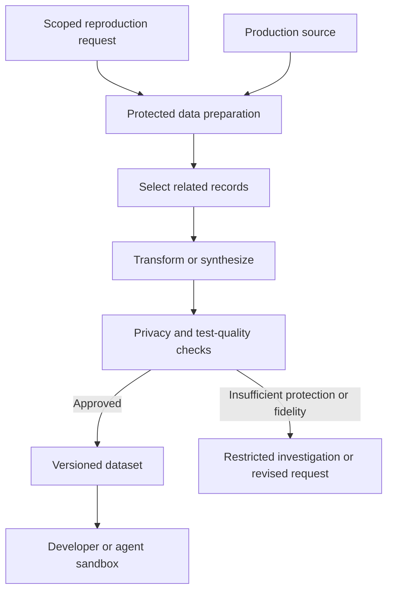

# Production-Like Test Data for Coding Agents

A report fails for one customer because a partial refund, several payments, and an imported document form an unusual combination. A developer needs the relationships and values that trigger the failure. Copying the entire production database into an agent's workspace exposes much more information than the investigation needs.

A test-data service can accept a bounded reproduction request, prepare an appropriate dataset in a protected environment, validate it, and deliver an approved result to a development sandbox. Agents can help specify transformations, create synthetic cases, and test the result. General coding access should not imply unrestricted access to the source data.

## Define what the test needs to preserve

Production-like is a property relative to the test. A correctness reproducer may need only a dozen related records. A query-performance test may depend on scale, distributions, indexes, skew, and database statistics. A migration rehearsal may need both realistic relationships and realistic volume.

State the invariant or failure mechanism before selecting data. For the refund example, the important properties may be the original payer, payment order, refund amount, document status, and cross-service identifiers. Real names and addresses may contribute nothing to the test.

| Purpose | Important properties | Common mistake |
| --- | --- | --- |
| Reproduce a business defect | Exact relationships and relevant state transitions | Masking away the condition that triggers the bug |
| Test an integration | Consistent identifiers and event formats across systems | Preparing each database independently |
| Measure a query | Volume, selectivity, skew, indexes, execution environment | Treating a tiny clean sample as a performance replica |
| Rehearse a migration | Old and new representations, edge cases, realistic scale | Testing only empty or newly created databases |
| Test privacy controls | Sensitive-field coverage and access paths | Checking only columns named `Name` or `Email` |

Avoid promising both perfect fidelity and complete anonymity for every dataset. Sometimes the unusual condition itself makes a person identifiable. The service needs a fallback: a synthetic reproducer, a more restricted analysis environment, or a recorded inability to release the dataset.

## Put preparation behind a separate trust boundary



The preparation service has a dedicated identity and access appropriate to its purpose. The coding agent submits a request such as "reproduce incident INC-204 using the approved refund scenario profile." It receives a dataset identifier, allowed use, expiry, and relevant evidence rather than a production connection string.

The service should validate the requester, incident or task scope, selection bounds, target environment, and transformation profile. Avoid accepting arbitrary SQL or an unrestricted export path from the caller. A tool named `prepare_safe_data` is only safe if its implementation and permissions enforce the contract.

Agents can draft or improve transformation code against schemas, synthetic examples, and approved samples. Changes to the release gate or masking profile require their own review and tests. The same agent should not be able to declare its own transformation sufficient and release raw data to itself.

## Preserve relationships across the whole case

Selecting one order often requires payments, refunds, ledger entries, documents, and reference tables. Traverse the relevant relationships deliberately. Some exist only in application logic, serialized messages, or another service's database rather than declared foreign keys.

Use consistent replacement of identifiers wherever the test needs joins to work. Independently transforming a customer identifier in Billing and Payments destroys the case. Coordinate the mappings within the dataset's permitted scope and keep any reidentification information in the protected zone.

Dates can encode ordering, expiry, age boundaries, and time-zone behavior. Amounts can encode rounding, reconciliation, or overflow conditions. Random replacement may produce plausible-looking records while removing the bug. Define transformations in terms of the properties to preserve, such as relative order or a particular difference between values.

Inspect unstructured fields too: free text, JSON, logs, documents, filenames, attachments, and embedded identifiers can contain personal data even when the relational columns look clean. Classification tools help find candidates; they do not prove complete coverage.

Tonic Structural documents [subsetting through declared and virtual foreign keys](https://docs.tonic.ai/app/generation/subsetting/subsetting-foreign-keys). Its documented handling of some circular relationships can alter links, so test whether the resulting dataset still preserves the scenario. This is a concrete example of why a tool's referential-integrity support does not replace scenario validation.

## Distinguish masking, pseudonymization, and anonymization

Masking describes a transformation or display restriction. It does not by itself establish that an individual can no longer be identified. Replacing names with stable identifiers can leave the data linkable to a person, particularly when rare attributes or external records remain available.

The EDPB's [FAQ on personal data](https://www.edpb.europa.eu/contact/frequently-asked-questions_en) distinguishes pseudonymized data, which remain personal data, from data rendered anonymous against reasonably likely means of identification. Whether a concrete release meets that standard needs assessment of the data, recipient, and available information, not a filename containing "anonymized."

SQL Server [Dynamic Data Masking](https://learn.microsoft.com/en-us/sql/relational-databases/security/dynamic-data-masking) changes what certain queries display; it does not transform the stored database into an anonymous export. Its documentation also discusses inference through queries. Do not treat enabling DDM as completion of test-data preparation.

Commercial preparation tools can supply useful mechanisms. [Delphix Masking documentation](https://masking.delphix.com/docs/latest/introduction-to-delphix-masking) describes masking operations; that documentation site now directs readers to its current portal. Evaluate the maintained product documentation and deployment for the actual data sources and requirements. A product category is not a privacy guarantee.

## A sandbox does not erase model processing

An agent can run on an isolated VM while sending prompts to an external model service. If a raw record appears in the prompt, the record has crossed that boundary. Removing the VM later does not remove copies already sent to the model provider, traces, application logs, backups, or generated artifacts.

The same issue exists when an agent's final answer includes an example row or copies a field into a regression fixture. Restrict outputs and inspect artifacts, not only network access during extraction. Telemetry should not accidentally become a second database of sensitive samples.

An AI component can be used inside an approved protected data-processing environment when its deployment, purpose, access, retention, and legal basis are appropriate. That is a separate design and authorization decision. Local inference may reduce external transfers, but it does not remove obligations around access and processing.

For the ordinary coding workflow, prefer delivering an approved transformed or synthetic dataset. [[Isolated Engineering Environments for Coding Agents]] explains the execution boundary; data preparation adds a different boundary around what information enters it.

## Validate privacy and usefulness independently

The privacy gate examines what can be exposed: direct identifiers, indirect identifiers, text fields, linkage risk, source mappings, and allowed recipients. Its evidence must match the applicable data policy and assessment; a regular-expression scan alone cannot prove anonymity.

The test-quality gate examines whether the dataset still does the required job: foreign keys resolve, business invariants hold, event order is preserved, the failure reproduces, or the relevant workload remains representative. Passing one gate does not imply passing the other.

For a defect, run the reproducer against the uncorrected implementation in the approved environment and confirm the expected failure. Then verify the correction against the same relevant case. If masking makes the failure disappear, investigate the lost property instead of claiming the production issue is fixed.

For performance, compare relevant distributions and query behavior, and report what the sample omits. For migrations, test both the transition and the applications that must coexist afterward. [[Production Feedback and Safe Automated Recovery]] describes the required compatibility and recovery evidence.

## Make the dataset a managed artifact

An illustrative manifest might contain:

```yaml
dataset_id: refund-case-v4
purpose: reproduce-INC-204
classification: approved-restricted-test-data
source_schema: billing-schema-N
transformation_profile: refund-profile-v8
permitted_environment: task-integration
retention_days: 7
invariants:
  - payment_refund_relationships_preserved
  - event_order_preserved
  - payer_replacement_consistent
evidence:
  - privacy-review-42
  - reproducer-run-19
```

Do not put raw source identifiers or secret mapping keys into a manifest delivered to the coding agent. Retain protected lineage separately where authorized staff can audit it.

Version the schema, transformation profile, synthetic generator, and dataset. Use stable identifiers in test reports so a failure can be reproduced without distributing a fresh production copy. Label whether the dataset is anonymous, pseudonymized, synthetic, or otherwise restricted according to the actual assessment.

Define expiry, access revocation, storage disposal, and artifact retention. Cancellation should trigger the same lifecycle checks as ordinary completion. Cleanup must cover snapshots, temporary files, exported reports, and other copies within the controlled system, with explicit limits for external retention.

## Use synthetic data when it preserves the important mechanism

A synthetic case can reproduce "two payments, a partial refund, and an imported document without a payer" without reproducing a customer's identity. Keep the generator and expected invariant with the regression test so future runs do not need production access.

Synthetic data are not automatically representative or private. A generator can copy source details or reproduce rare combinations, and a convenient distribution can miss the workload that caused a performance defect. Validate the claimed properties rather than assume them from the generation method.

Over time, repeated requests can become reusable scenario profiles. If agents repeatedly need the same payment edge case, improve the provisioning service or generator. Measure preparation latency, failed validation, and reproduction success. That makes environment quality part of process improvement rather than a manual prerequisite everyone repeats.

## Related notes

- **[[Production Feedback and Safe Automated Recovery]]** — Moves from a production incident to a verified repair.
- **[[Acceptance Policies and Automated Repair in Agentic SDLC]]** — Protects the gates and evidence used to release artifacts.
- **[[Agentic Coding with EF Core and SQL Server]]** — Applies agent workflows to concrete database behavior.
- **[[Conversation History as Sensitive Data]]** — Covers information retained beyond the working environment.
