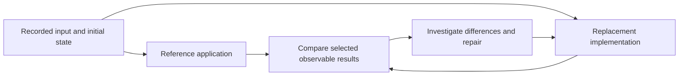

# Existing Software as a Blueprint for AI Agents

A coding agent asked to build a spreadsheet starts with many unanswered questions. How should formulas behave? What happens when a referenced cell is empty? Which formatting survives a save and reload? A working spreadsheet application gives the agent concrete behavior to inspect and results to compare with its own implementation.

That reference can reduce three kinds of work: discovering requirements, choosing familiar interactions, and checking whether the new program behaves as intended. The agent can observe an operation, implement it, compare results, and repeat. Existing software may also supply running components that can be connected into a new experience.

This helps explain why recognizable applications and surprising game combinations can emerge from agent-assisted projects. It also explains the limits of the evidence. Reproducing selected behavior is an achievement; it does not establish full compatibility, production reliability, or the ability to replace the original business.

## What the Published Examples Actually Show

### Familiar Applications Rebuilt as New Implementations

October 2026 coverage describes Brandon Thomas's ArtCraft projects as AI-assisted attempts to reproduce Adobe applications and, subsequently, Microsoft Office applications. That reporting establishes the public development story, rather than an independently measured comparison of engineering cost or compatibility. [Reporting on the Adobe and Office projects](https://www.tomshardware.com/software/microsoft-office/creator-of-free-adobe-clones-unveils-open-source-microsoft-office-excel-powerpoint-and-word-replications-autodesk-tools-and-other-subscription-based-services-may-come-next).

The primary project pages make the scope more concrete. ArtCraft lists image, video, document, presentation, and spreadsheet tools, including PhotoCraft, WordCraft, DeckCraft, and GridCraft. As checked on October 16, 2026, the catalog labels applications as early alpha or in development. WordCraft describes itself as a clean-room reimplementation of Microsoft Word based on public specifications and observation. These are project descriptions, including the clean-room claim, rather than an independent audit. [ArtCraft application catalog](https://getartcraft.com/apps), [WordCraft repository](https://github.com/storytold/wordcraft).

The cases show published attempts to build substantial alternatives around recognizable workflows. The applications were not executed or compatibility-tested for this note. Their repositories and feature lists do not establish that all advertised behavior works, that remaining defects are inexpensive to fix, or that a complete replacement is inevitable.

### Games Combined Through Their Running Processes

ArkWeb illustrates a different mechanism. According to its documentation, it runs Marvel's Spider-Man Remastered and Batman: Arkham Knight simultaneously. Spider-Man supplies movement, while collision geometry from Gotham is transferred into its physics world. The rendered character is composited into Arkham's view, with position and camera synchronization. The project requires both games and describes itself as experimental, with known collision, lighting, and animation limitations. [ArkWeb documentation](https://github.com/luki-1/ArkWeb).

This is an integration of existing programs. It does not demonstrate independent replacements for either game. The documentation provides a concrete account of the mechanism, but this note does not verify its runtime behavior or measure how much development work AI saved.

The distinction matters when interpreting a demonstration:

| Approach | What is built | What still comes from the original |
|---|---|---|
| Reimplementation | A new program reproducing selected behavior | Observed requirements, specifications, and comparison results |
| Modification | Changes to an existing program's behavior | Much of the original implementation and runtime |
| Integration | A connection between existing programs | The running capabilities of the connected programs |

Each can produce something useful. Each supports a different claim about what the author actually built.

## A Working Product Supplies Part of the Specification

When building an original product, a team must discover which operations matter and how they should fit together. A reference product has already made many visible decisions: navigation, editing gestures, validation messages, file operations, and the order of steps in a workflow. An agent can inspect those decisions instead of inventing every detail.

For a web application, the browser also exposes requests and responses. Watching a record move from draft to approved can reveal identifiers, state transitions, and payload shapes. The replacement backend can implement those observable contracts with a different database schema and internal architecture. It needs to support the chosen behavior; it does not need to reproduce the original service topology.

Observation remains incomplete. A visible approval button does not reveal every permission rule, concurrent update condition, or integration failure. Screenshots reveal even less than an interactive session. The agent needs access to representative states and operations before it can turn observations into useful requirements.

When source is available, alternate observation with code inspection. A conditional can reveal a customer category or configuration limit that ordinary exploration never exercised. Run those cases against the reference to check the interpretation. Trace state writers as well as readers: the same Save action may consume different values after a different sequence of edits, and a successful response may precede background work that later fails.

Record what each source of evidence establishes. An observed result describes the exercised conditions; a source-derived rule may still depend on unresolved runtime configuration. Keep discrepancies and unknowns visible instead of treating the agent's explanation as a recovered specification. [[Recovering Legacy System Behavior with AI Agents]] develops this investigation for an owned legacy system before a rewrite.

A familiar interface also supplies a design starting point. That can reduce experimentation, but it does not establish that the original design fits a new audience. The team still needs to decide which behavior to preserve, simplify, or deliberately change.

## The Original Can Become Part of the Test Harness

Consider rebuilding the subset of a spreadsheet engine used by an internal reporting tool. Instead of checking only whether the agent's formulas look plausible, the team can run the same workbook through the original engine and the replacement.

The reference supplies expected observations. This is differential testing: both implementations receive equivalent inputs, and a comparison checks the outputs that matter. It is also useful during migrations of software a team already owns (see [[Large-Scale Code Migration with AI Agents]]).

A practical loop needs more than two executable files:

1. **Fix the comparison conditions.** Record the reference version, input, initial state, locale, and relevant settings. Control time and randomness where they affect results.
2. **Choose observable results.** For a spreadsheet, compare values and error results. For an editor, also inspect saved content, layout, and behavior after reopening. A matching screenshot alone cannot establish that a document was preserved.
3. **Capture a reproducible difference.** Give the agent the smallest useful failing example, the expected observation, and the actual result.
4. **Repair and repeat.** Run the failing case and the accepted regression cases again. Keep accepted expectations protected while changing the implementation.

Comparisons involving state changes need isolated effects. Replaying an order submission against two live systems could create two orders. Use controlled environments and resettable data, or capture results for later replay. Normalize irrelevant differences, such as generated identifiers, without hiding meaningful differences in ordering, permissions, or persistence.

The original is a reference for compatibility, not an unquestionable definition of correctness. It may contain bugs that users depend on, behavior the new product intentionally rejects, or nondeterministic results. The team must distinguish a compatibility requirement from an approved difference. An agent should not quietly redefine the expected result to make its implementation pass.

Passing every comparison establishes agreement on the exercised cases. It does not prove complete equivalence. Rare document structures, long sequences of edits, concurrency, performance, and recovery may remain untested. Someone still has to choose representative cases and identify missing coverage (see [[Testing in the Model, Agent, LLM Era]]).

## Access Determines What Can Be Learned and Reused

The available evidence changes with the delivery model:

| Available access | What it can reveal or support | Important limit |
|---|---|---|
| Source code and build tools | Internal logic, dependencies, and direct experiments | Understanding and modifying a large system still requires work; access does not settle reuse rights |
| A local binary | Repeatable execution, debugging, traces, and inspection of parts of the implementation | Optimization, missing symbols, obfuscation, and remote dependencies can make analysis difficult |
| A browser client | Interface behavior, delivered client code, and exposed network contracts | Server internals, private data, and unvisited states remain hidden |
| A remote API | Input-output observations and error behavior | Quotas, latency, nondeterminism, and restricted inputs can constrain exploration |

A local executable offers more opportunities to inspect and alter execution than a remote service exposing only requests and responses. ArkWeb is a concrete illustration of the access needed for integration through local processes. It should not be generalized into a claim that arbitrary binaries are easy to combine.

Binary distribution can therefore expose valuable implementation evidence, but it does not make every desktop application easier to replace than every website. A small online workflow may be easier to reproduce than a local engineering tool with complex numerical behavior. The relevant questions are what can be observed, how cheaply it can be tested, and what unavailable capabilities the result depends on.

## A Fast Demonstration Does Not Predict the Cost of Completion

A reference makes the target clearer. It does not guarantee that an early architecture can support the whole target.

An editor may handle ordinary paragraphs yet require a different layout model to support tables spanning pages, floating images, and changes that must survive a save and reload. A spreadsheet may calculate simple formulas correctly while its dependency model fails on larger workbooks. Repeated patches can expose a structural mistake that requires rebuilding part of the implementation.

The visible demonstration may cover a carefully chosen path. Its remaining work can include file compatibility, data preservation, performance, failure recovery, accessibility, integration behavior, and ongoing maintenance. Some projects will never complete that work. Early speed is evidence about reaching the demonstrated scope, not a schedule for reaching maturity (see [[How AI Changes Prototyping and the Path from PoC to Production]]).

A competitor nevertheless may not need complete coverage. A company using two capabilities from a commercial library could build and maintain those two, provided they work reliably for its needs. An editor serving a narrow workflow may succeed without matching every feature of a general office suite. This is the economic pressure described in [[AI Changes the Economics of Software Libraries]]: the relevant comparison is the cost of owning a sufficient implementation against the value of the purchased package.

Full compatibility and narrow usefulness are different goals. A credible claim names which one was attempted and what was actually checked.

## Reproducing Software Does Not Reproduce Its Business

A mature supplier can offer much more than an executable: hosted collaboration, storage, integrations, account administration, support, migration assistance, and a record of handling failures. Customers may also have templates, extensions, training, and working relationships built around the product. A replacement has to justify the cost and risk of changing that environment.

The distinction is especially clear with marketplaces. A team could reproduce the catalog, search, shopping cart, seller accounts, and order workflow of a marketplace such as Allegro or Amazon. That would not give it the same buyers, sellers, transaction volume, reputation, or operating relationships. Sellers need customers; customers need useful offers and reasons to trust the transaction. The technical platform is only part of the market.

Lower implementation cost can make entry into a niche practical without removing these advantages. A clone might pressure one product segment while the established supplier remains strong elsewhere. [[Software Implementation Is Becoming a Weaker Moat]] develops this distinction between reproducible functions and accumulated business value.

## Hiding Execution in the Cloud Is a Possible Response

One possible supplier response is to keep valuable computation on its servers while distributing a local interface. A specialized optimization engine or processing pipeline would then be available through an API without delivering its executable to every customer. The supplier could also control the rate and scope of queries used to explore its behavior.

This is a hypothesis about incentives, not an established trend demonstrated by the projects above. Remote execution reduces direct access to implementation details. It still exposes behavior that someone may reproduce with a different implementation, and it cannot hide client code already delivered to a browser or desktop app.

The trade-off can also weaken the offer. Remote computation brings hosting costs, network latency, outages, and data-transfer concerns. Offline operation, privacy, and responsiveness may give a local alternative an advantage. For a remotely streamed game, local process integrations like the ArkWeb mechanism would be much harder, but the player would also become dependent on the streaming service.

Execution location can therefore become both a technical decision and a decision about how much control the supplier retains over inspection and modification. Protecting implementation and serving the customer do not always favor the same architecture.

## Technical Feasibility and Reuse Rights Are Separate Questions

Reproducing behavior, copying code, reusing assets, and modifying a running application are different acts. A project's description of itself as clean-room does not by itself establish its legal position.

In the EU's *SAS Institute v World Programming* judgment, the Court distinguished program functionality from the expression protected by copyright in computer programs. That distinction does not settle a particular project's use of protected code or other materials, and it does not resolve separate patent, license, or access questions. [Court of Justice explanation of the judgment](https://curia.europa.eu/jcms/upload/docs/application/pdf/2012-05/cp120053en.pdf).

The engineering conclusion is narrower: a working reference can reduce uncertainty and give an agent useful feedback. The strongest result is a defined capability with reproducible evidence, clear remaining gaps, and a credible maintenance plan. That can be valuable well before a complete replacement exists, while leaving much of the original supplier's product and business advantage intact.
